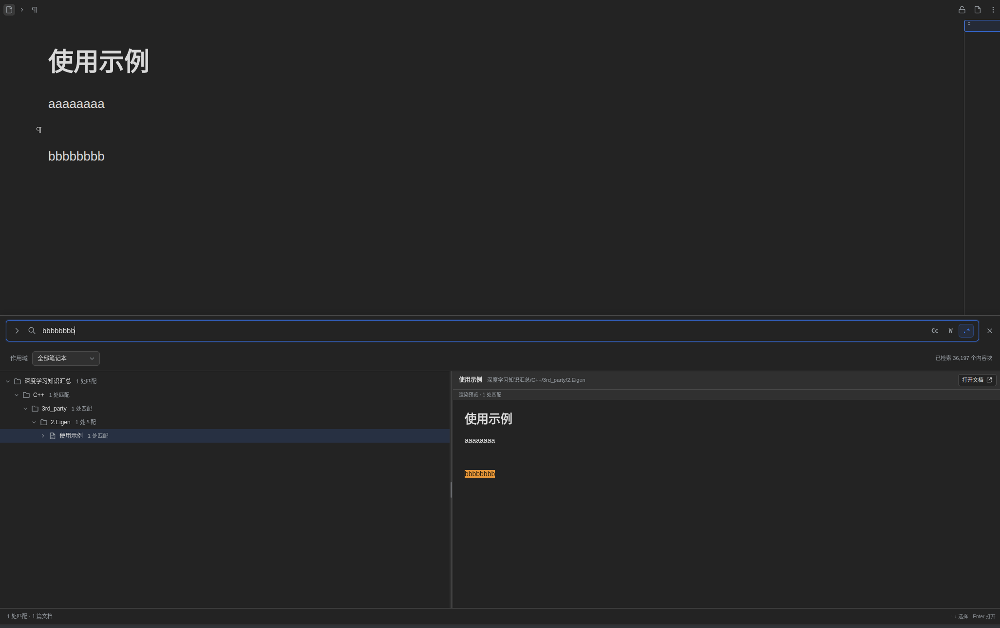

# 思源 IDE 搜索

像 PyCharm 一样，在思源笔记中查找与替换文字。



## 主要功能

- **当前文档查找**：选中文字后按 `Ctrl+F` 自动填入搜索词，保留当前位置；支持上一处、下一处和全文高亮。编辑或删除匹配文字后，刷新高亮和计数时保留光标与滚动位置。
- **全局搜索**：按 `Ctrl+Shift+F`，在文档区底部打开查找面板。左侧按笔记本、目录、文档组织结果，默认展开到文档层级；手动展开文档可查看具体匹配行。
- **完整文档预览**：右侧渲染当前选中的文档，自动定位匹配；双击结果可打开完整文档。拖动面板上边缘调整高度，中间竖线调整左右比例。
- **匹配选项**：`Cc` 区分大小写，`W` 整词匹配，`.*` 启用正则表达式。三个选项关闭时按普通文本包含匹配。
- **替换与撤销**：点击搜索框左侧箭头展开替换，支持单个替换、当前范围内全部替换、全局替换和撤销替换。

## 快捷键

| 操作 | Windows / Linux | macOS |
| --- | --- | --- |
| 当前文档查找 | `Ctrl+F` | `⌘F` |
| 全局搜索 | `Ctrl+Shift+F` | `⇧⌘F` |
| 下一个／上一个页内匹配 | `Enter` / `Shift+Enter` | 相同 |
| 切换大小写／整词／正则 | `Alt+C` / `Alt+W` / `Alt+R` | `⌥C` / `⌥W` / `⌥R` |
| 关闭页内搜索／快速弹出框 | `Esc` | `Esc` |

## 插件设置

| 设置 | 默认 | 说明 |
| --- | --- | --- |
| 使用 PyCharm 搜索快捷键 | 开启 | 接管查找快捷键；也可通过顶栏搜索图标或命令面板打开搜索。 |
| 全局搜索先打开快速弹出框 | 关闭 | 开启后先使用上下布局的弹出框，再通过右下角「打开查找窗口」切换到底部面板。 |
| 查找窗口在点击外部时关闭 | 关闭 | 关闭时可保留底部面板，通过右上角 × 关闭；开启后，点击面板外部或按 Esc 关闭。 |

## 安装与兼容性

支持思源 **3.8.0 及以上**的桌面客户端、桌面浏览器和独立文档窗口；主要用户实测版本为 **3.8.8**。

在思源「设置 → 集市 → 插件」中安装 **IDE 搜索**，并在已下载插件中启用。

手动安装：下载 Release 附件 `package.zip`，将其中内容解压到工作空间的 `data/plugins/siyuan-search/`，确认该目录下直接存在 `plugin.json`，然后重新加载思源并启用插件。

全局搜索读取思源已保存的索引，结果最多展示 1,000 处；不包含附件正文、关闭或尚未建立索引的笔记本。执行批量替换前请确认搜索范围，替换后可使用「撤销替换」。

## 开发

需要 Node.js 22.18+ 和 Python 3。

```bash
npm ci
npm run package
```

构建生成 `dist/`、供 GitHub Release 上传的 `package.zip` 和带版本号的 ZIP，并自动校验发布包。可使用 `npm run check:package` 再次检查现有安装包。发布步骤及集市 PR 文案见 [PUBLISHING.md](https://github.com/wave789/siyuan-search/blob/main/PUBLISHING.md)，版本变化见 [CHANGELOG.md](CHANGELOG.md)。

## 反馈与支持

[提交问题](https://github.com/wave789/siyuan-search/issues) 


